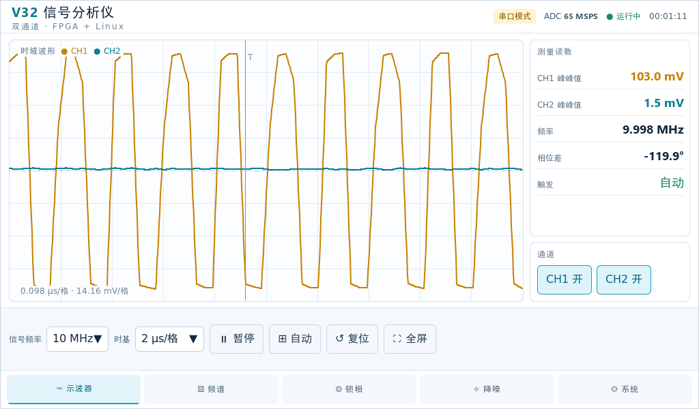

# RK3506 波形 / 频谱分析仪（7 寸 MIPI 屏 + V32CAP3 FPGA 串口前端）

跑在 **RK3506 EVB** 上的示波器风格仪器界面。**不是 PC 程序**：直接写 DRM/KMS 上屏、
自己读 `/dev/input/event0` 做多点触摸，串口收 FPGA 发来的 4096 点双通道采样帧。

| 页面 | 内容 |
|---|---|
| ⌁ 示波器 | 双通道时域波形，V/div、T/div、触发、单通道开关 |
| ▥ 频谱 | 8192 点 radix-2 FFT + 汉宁窗，峰值频率 / 峰值电平 / 底噪 / 频率分辨率 |
| ◎ 锁相 | 数字锁相：I/Q 矢量图 + 时间历程，Goertzel 求相位差 |
| ✧ 重建 | 原始采样点 vs 带限插值重建（同一时间窗，两图对齐），右上角标出波形类型 |
| ⚙ 系统 | 渲染帧率、链路吞吐、丢包统计等板载实测值 |

现在的数据源是 **真实串口**（`--source uart`，默认 921600 8N1，5.6 fps）；
`--source demo` 切回本地合成信号，没有板子也能跑。数据源是可插拔接口（见第 8 节）。



界面是**白底 + 中文**，按钮条从左到右：`⏸ 暂停` / `⊞ 自动` / `↺ 复位` / `⛶ 全屏`。

**`⊞ 自动`**：按 FFT 实测的峰值频率把窗口框成**正好 10 个完整周期**，
纵向满刻度设成**峰峰值的 110%**（波形居中，上下各留 5%）。10 MHz 实测结果
是 `0.100 µs/格`、`139.63 mV/格`（8 格 × 139.63 = 1.117 V = 1.10 × 1.0155 V）。

---

## 0. 先看效果

没有板子也能看界面：双击 `preview.html`，PC 上的预览稿用的是同一套配色和布局，
可以先确认长相（预览稿不放真数据，只做静态版式）。

真机截图在 `docs/screenshots/`：

| 文件 | 页面 |
|---|---|
| `01-scope.png` | 示波器 · 运行中 |
| `02-fft.png` | 频谱 |
| `03-lock.png` | 锁相 |
| `04-ai.png` | 重建：30 MHz 原始点 vs 带限重建 |
| `05-system.png` | 系统 |
| `06-paused.png` | 暂停冻结后放大查看 |


---

## 1. 关键前提：这块板子**没有 framebuffer**

一开始按常规思路写的是「LVGL + `/dev/fb0`」，上板才发现走不通：

```
/proc/fb            -> 空
/proc/devices       -> 只有 226 drm
/dev/dri/card0      -> 有
/dev/fb0            -> 不存在
```

官方固件（`BR2_PACKAGE_LVGL_VERSION_9=y` + `BR2_LV_USE_RKADK=y`）里，显示后端走的是
Rockchip 自家的 **RKADK**，它直接走 DRM，不提供 fbdev 兼容层。
而 RKADK 的库只有把整个 buildroot 编一遍才有，**SDK 里 buildroot 至今没编通过**。

所以这套 demo 的显示部分是自己写的，完全不依赖 RKADK：

| 项目 | 做法 |
|---|---|
| GUI 框架 | LVGL **9.1**（SDK 里现成的 `buildroot/dl/lvgl/lvgl-9.1.tar.gz`） |
| 显示 | **自己写的 DRM 后端** `src/drm_disp.c`（纯内核 UAPI ioctl，见第 2 节） |
| 输入 | **evdev** 触摸（LVGL 自带 `lv_evdev`，自动扫描 `/dev/input/event*`） |
| 链接方式 | **静态链接**，不怕板子上的 libc 版本对不上 |

结果是一个 **648 KB 的独立可执行文件，拷进去就能跑，不用重编固件**。

---

## 2. 为什么不用 LVGL 自带的 `lv_linux_drm`

LVGL 9.1 里确实有 DRM 后端，但这里有两个绕不过去的坎：

1. **它要链 `libdrm.so`**。而交叉工具链的 sysroot 里只有 `libdrm.so` / `libdrm.so.2` /
   `libdrm.so.2.4.0`，**没有 `libdrm.a`** —— 一旦依赖它，就没法做全静态链接。
   板子上跑的东西，静态链接省心太多（不用担心 rootfs 里缺哪个 .so）。
2. **它按「第一个格式匹配的 plane」提交**，在 Rockchip VOP 上未必选中 primary plane，
   而且它走 atomic 提交，出问题时不好判。

于是改成 `src/drm_disp.c`：**只 include 内核 UAPI 头**（`<drm/drm.h>`、`<drm/drm_mode.h>`、
`<drm/drm_fourcc.h>`），自己发 ioctl。走的是 legacy 路径（atomic-only 的驱动会自动
回落到 `drm_atomic_helper_set_config`，所以兼容）：

```
DRM_IOCTL_SET_MASTER
MODE_GETRESOURCES    (两段式：先问数量再取数组)
MODE_GETCONNECTOR    (两段式)
MODE_GETENCODER
MODE_CREATE_DUMB  +  MODE_MAP_DUMB + mmap     -> 两块 dumb buffer
MODE_ADDFB2
MODE_SETCRTC         (首次 modeset 和之后的翻页都用它)
```

**双缓冲零拷贝**：这两块 dumb buffer 直接交给
`lv_display_set_buffers(disp, buf1, buf0, size, LV_DISPLAY_RENDER_MODE_DIRECT)`，
LVGL 直接往显存里画；flush 回调里对「不是当前 front 的那块」发一次 `MODE_SETCRTC` 完成翻页。
`LV_COLOR_DEPTH 32` → `LV_COLOR_FORMAT_XRGB8888`，和 `DRM_FORMAT_XRGB8888` 完全对应。

板子上的实测参数（`--drm-info` 可复现）：

```
driver      : rockchip 4.0.0  (RockChip Soc DRM)
dumb buffer : 支持
addfb2 mod  : 支持
atomic cap  : 支持
conn id=75 type=DSI-1 status=connected
  mode[0] 1024x600 @49Hz  clock=42000  type=0x48 PREFERRED
  -> crtc=72  encoder=74
dumb probe  : 1024x600 bpp32 -> pitch=4096 (期望 4096)
```

---

## 3. 目录结构

```
waveform_demo/
├── CMakeLists.txt            构建脚本
├── toolchain.cmake           交叉编译工具链（RK3506 / ARMv7-A / hard-float）
├── lv_conf.h                 LVGL 配置
├── build.sh                  在 Ubuntu 编译机上执行
├── push_build.sh             编译 + 拉回二进制一条龙（密码走 BUILD_PASS 环境变量）
├── deploy_net.sh             通过**以太网**部署（推荐，见第 5 节）
├── deploy.sh                 旧的 adb push 部署
├── deploy/S90waveform_demo   开机自启脚本（init.d）
├── preview.html              PC 静态预览稿
│
├── src/
│   ├── main.c                入口：命令行解析、主循环、--tap / --pinch 注入
│   ├── ui.c / ui.h           ★ 五个页面 + 顶栏 + 控制条，所有中文文案在这里
│   ├── theme.h               ★ 全部配色常量（改主题只动这个文件）
│   ├── plot.c / .h           自绘折线 / 频谱 / 矢量图控件（LVGL custom draw）
│   ├── port.c / port.h       ★ 板级移植：DRM 上屏 + evdev 多点触摸 + 双指手势状态机
│   ├── drm_disp.c / .h       自己写的 DRM 显示后端（纯内核 UAPI，双缓冲 page flip）
│   ├── v32cap3.c / .h        ★ V32CAP3 16428 字节帧解析 + CRC32
│   ├── wave_source.c / .h    数据源抽象（demo / uart 两种实现）
│   ├── wave_source_v32.c     uart 数据源：串口收帧 → 解成 CH0/CH1
│   ├── demo_signal.c / .h    本地合成信号（无板子时用）
│   ├── fft.c / .h            radix-2 FFT + 汉宁窗 + 幅度谱 + Goertzel
│   ├── bl_interp.c / .h      ★ 带限（sinc 多相 FIR）重建，30 MHz 靠它才看得见
│   ├── bl_coef.h             ★ 插值系数表（脚本生成，20 相 × 129 抽头，别手改）
│   └── fonts/                ★ 位图字体子集（由 tools/gen_v32_fonts.py 生成）
│
├── docs/
│   ├── V32CAP3_FPGA_TX_SPEC.md   FPGA 侧发送端规范（给写 Verilog 的人看）
│   ├── rtl/uart_tx.v             8N1 发送器参考实现
│   ├── rtl/v32cap3_tx.v          成帧 + CRC + 发送总控参考实现
│   ├── tools/check_frame.py      抓一帧校验格式对不对
│   ├── tools/make_handoff_zip.py 生成给 FPGA 工程师的交接包
│   └── screenshots/              真机截图
│
├── V32CAP3_FPGA_TX_handoff.zip  上面 docs 里内容的打包版（直接发人）
│
└── tools/
    ├── gen_v32_fonts.py      ★ 扫描源码字符串 → 重新生成字体子集（加字必跑）
    ├── adb_shot.sh           板子截图（kill -USR1 触发 → adb pull → PNG）
    ├── board_shot.py         截图 + 裁剪 + 对比
    ├── diff_shot.py          两张截图逐像素 diff（判断界面有没有被改动）
    ├── cmp_shot.py           多张截图并排拼图
    ├── board_tap_test.sh     在板子上验证触摸点击
    ├── send_frame.py         从 PC 往板子串口灌帧
    ├── serial_frame_sender.html  浏览器 WebSerial 连续发帧 + 噪声可调 + 网页端显示
    ├── render_ref.py         批量出参考图
    └── _test/                纯 PC 端的 FFT / 协议单元测试替身
```

---

## 4. 编译

源码放在 Ubuntu 编译机的 `~/waveform_demo/project/`，LVGL 在 `~/waveform_demo/lvgl-release-v9.1/`。

```bash
ssh lqnm@192.168.8.130
cd ~/waveform_demo/project

./build.sh          # 增量编译，改完代码几秒钟
CLEAN=1 ./build.sh  # 全量重编（LVGL 约 1 分钟）
```

产物在 `~/waveform_demo/out/waveform_demo`。从 Windows 拷回来：

```bash
# Windows 侧
SSH_PASS=xxx python scripts/sftp_get.py \
    /home/lqnm/waveform_demo/out/waveform_demo \
    G:/Desktop/Project/GC9503CV/waveform_demo/out/waveform_demo
```

> ⚠️ 往编译机传文件时，**远程路径参数必须加 `MSYS_NO_PATHCONV=1`**。
> 否则 MSYS 会把 `/home/lqnm/...` 改写成 `E:/Program Files/.../home/lqnm/...`，
> 结果在编译机上凭空建出一棵 `~/E:/Program Files/...` 的垃圾目录树
> （脚本本身不报错，只是「上传完成」。

**工具链**：SDK 自带的 `arm-none-linux-gnueabihf-gcc`（glibc 2.38，
和板子上的 glibc 完全一致）。

---

## 5. 部署到板子

### 5.1 推荐：走以太网 + SSH

这块板子的 **USB gadget 会反复重新枚举**，内核日志里能看到
`dwc2 ff740000.usb` 在几秒内 re-enumerate 好几次。表现就是 adb 频繁报
`no devices/emulators found` / `device offline`；**更糟的时候 Windows 侧连 USB 设备
都枚举不到**（`pnputil /enum-devices /connected` 里看不到任何 USB 复合设备），
这时 `adb kill-server` 也救不回来，只能拔插线。

而板子网口上的 **sshd 一直是稳的**，所以部署改走 SSH。拓扑：

| 链路 | 地址 |
|---|---|
| PC 以太网 | `192.168.1.1/24` |
| 板子 eth0 | `192.168.1.10/24`（默认路由也在这，网关就是 PC） |

**板子 root 密码是 `root`** —— 不是猜的，来自 SDK 里这块板子对应的 buildroot defconfig：

```
buildroot/configs/rockchip_hd_rk3506g_evb_nand_defconfig:540
BR2_TARGET_GENERIC_ROOT_PASSWD="root"
```

（用 `openssl passwd -1 -salt C/9STJHY root` 算出来和板子 `/etc/shadow` 里
`$1$C/9STJHY$aLr26NDd5v9iXX5t61Mw70` 逐字节一致，已验证。）

```bash
# Windows 侧，waveform_demo/ 目录下
./deploy_net.sh            # 推送 + md5 校验 + 重启 demo
NO_RUN=1 ./deploy_net.sh   # 只推不启动
```

脚本内部是 `scripts/board_push.py`：SFTP 传到 `xxx.new` → 比对两端 md5 →
**只有一致才 `mv` 覆盖**，所以不会出现「push 报成功但板子上是旧文件」。

> ⚠️ 起后台进程时结尾一定要 `</dev/null`：
> `nohup ./waveform_demo ... > /tmp/app.log 2>&1 </dev/null &`
> 否则后台进程继承着 SSH 通道的 stdin，通道不关闭，客户端会一直卡到超时。

### 5.2 备选：USB ADB

adb 还能用的时候（板子 USB 没掉）也可以：

```bash
adb push out/waveform_demo /tmp/
adb shell 'chmod 755 /tmp/waveform_demo'
```

adb 的路径参数要 `MSYS_NO_PATHCONV=1`，否则 `/tmp/x` 会被本地 MSYS 改写成
`C:/Users/.../Temp/x`，push 会「报 1 file pushed 但其实什么也没传」。

### 5.3 启动

**官方 lv_demo 必须先杀掉**（它占着 DRM 和输入设备）。开机自启脚本是
`/etc/init.d/S99lvgl-test`：

```bash
adb shell '
  killall -9 waveform_demo lv_demo rk_demo 2>/dev/null
  cd /tmp
  nohup ./waveform_demo --view wave --snap-file /tmp/shot.ppm > /tmp/app.log 2>&1 &
  sleep 3; cat /tmp/app.log
'
```

正常应该看到：

```
=== waveform demo ===
[port] 没有 framebuffer 设备，改用 DRM: /dev/dri/card0
[drm] 选中 conn=75 (DSI-1) crtc=72  mode="1024x600" 1024x600 @49Hz
[drm] display: /dev/dri/card0 conn=75 crtc=72 1024x600 @49Hz  fb=77/78 pitch=4096
[port] touch: /dev/input/event0
[port] touch 量程: x 0..1024  y 0..600 (已显式标定)
[app] wave source: demo, fs=4000 Hz, frame=512
```

后台跑的时候**一定要 `nohup ... &` 并重定向输出**，否则 adb shell 一退出进程就被带走了
（表现是「截不了图」「进程莫名没了」）。

---

## 6. 界面说明

五个页面，底部导航切换：`示波器` / `频谱` / `锁相` / `重建` / `系统`。
右侧是读数面板，底部是控制条（信号频率、页内参数、`暂停` `自动` `复位` `全屏`）。

界面是**白色主题 + 中文**（第六版改的，原来抄参考稿的深色 + 英文）。
配色全部集中在 `src/theme.h` 的「配色」一段，换主题只改那一块，其余代码只引用宏。

### 触摸手势

| 手势 | 作用 | 说明 |
|---|---|---|
| 单指点按 | 按钮、下拉框、chip | 正常点击 |
| **两指横向捏放** | 时基 **µs/格** | 张开 = 放大（看更短的一段），捏拢 = 缩小（看整帧） |
| **两指纵向捏放** | 幅度 **mV/格** | 张开 = 波形变高（每格毫伏变小），捏拢 = 变矮 |
| `自动` 按钮 | 时基回整帧、幅度回 1:1、恢复运行 | 示波器的 Auto Set |
| `复位` 按钮 | 同上，另外把下拉框、通道、降噪开关也回默认 | |

两个读数直接写在波形区左下角：`6.302 µs/格 · 14.16 mV/格`。

手势方向是**在开始阶段判定的**（两指间距超过 24 px 时比 |dx| 和 |dy|），
整个过程不再改轴，所以斜着捏也不会忽横忽竖。纵向用的是整帧自动量程 × 用户增益，
所以放大缩小不会让 Vpp 读数跟着跳。

> 实现上 `lv_evdev` 用不了（只支持单点，且一个 evdev fd 只能有一个读者），
> 所以 `port.c` 自己读 `/dev/input/event0`。这块屏是 **MT Protocol A**
> （没有 `ABS_MT_SLOT`），每个触点一段 `SYN_MT_REPORT`、整帧一个 `SYN_REPORT`。
> 手势状态在「两指变一指/零指」时**立刻复位**，另有 600 ms 无事件兜底 ——
> 否则一旦漏掉抬手帧，状态会永远卡在「捏合中」：下一次捏合拿上次的间距当基准
> （张开放大反而变小），单指也会被当成残留手指，按钮全点不动。

### 暂停 = 冻结这一屏

按下 `暂停` 不只是停住动画，是**停止取数**：

* `real_update()` 一进来就 `if(!S.running) return;`，不再调 `read_frame2`，
  所以整帧样点、Vpp / 频率 / 相位、FFT 幅度谱**全部停在按下那一刻**；
* 波形左下角会变成 `⏸ 已冻结 · 6.302 µs/格 · …`，顶栏变 `● 已暂停`，
  一眼能和「链路断了（一条零线）」区分开；
* 冻结期间**两指捏放照旧生效**，可以对着这一屏静止数据放大、平移看细节
  —— 这就是「保留一定时间长度来查看」；
* 恢复运行时数据源那边只保留最新一帧，所以立刻回到实时，不会补播一堆旧帧。

> 实现上关键的一点：不能走「先把 `s_real_valid` 置 false、等新帧再置回」的
> 正常路径，否则按下暂停的瞬间波形会全归零 —— 那不是暂停，是断开。

### 自动（Auto Set）

捏乱之后（波形超出屏幕、或者被压成一条线）按 `自动`：
横向回整帧（`s_zoom_span = 0`）、纵向增益回 1:1、两路都打开、并恢复运行。
纵向量程本来就是每帧按 min/max 自动算的，所以增益回 1.0 就等于「自动量程铺满 8 格」。

### 按钮坐标（1024×600，注入点击时用）

底部导航 y=572：`示波器` 108 / `频谱` 310 / `锁相` 512 / `重建` 714 / `系统` 915。
控制条 y=496：`暂停` 363 / `自动` 437 / `复位` 515 / `全屏` 604。

分辨率不写死，从 display 读，换屏不用改代码。

> 控制条上的「噪声」滑条在第六版**已删除**：接真实链路之后它改不动任何东西
> （噪声是 FPGA 采回来的），删掉后正好腾出位置放 `自动`。

---

## 7. 参数在哪调

| 想改什么 | 改哪里 |
|---|---|
| 采样率、帧长 | `src/wave_source.h` 的 `WAVE_SAMPLE_RATE` / `WAVE_FRAME_LEN`（帧长必须是 2 的幂） |
| 假信号的频率和幅度 | `src/wave_source.c` 顶部的 `DEMO_F1_HZ` / `DEMO_A1` 等宏 |
| 刷新率 | `src/main.c` 的 `REFRESH_MS`（默认 100 ms） |
| 自动轮播周期 | `src/main.c` 的 `AUTOSWITCH_MS` |
| **配色 / 主题** | `src/theme.h` 的「配色」一段（白底主题，别在别处硬编码颜色） |
| 界面文案 | `src/ui.c`（改完**必须**重跑 `tools/gen_v32_fonts.py`，见 7.1） |
| 串口波特率 | `/etc/waveform_demo.baud`（内容 `921600` 或 `2000000`），改完重启服务；临时验证用 `--baud` |

### 7.1 字体是按文案生成的子集，加字要重跑

`src/fonts/lv_font_v32_*.c` 不是通用字体，是 `tools/gen_v32_fonts.py`
按「参考稿 HTML + 本工程 `src/ui.c` / `src/plot.c` 里的字符串字面量」生成的子集
（当前 322 个字符，其中汉字 208 个）。所以：

```sh
python tools/gen_v32_fonts.py     # 改完任何上屏文案都要跑一次
```

不跑的话新字在屏幕上是**空白方块**，编译期不会有任何提示。

两个坑写在这里省得再踩：

* 扫的是**字符串字面量**，先剥掉注释 —— 否则随手写的中文注释会把字符集撑到几百字；
* 第六版起**粗体档也含汉字**（`BOLD_FONT_PLAN` 里加了 simhei）。
  原来是「参考稿里没有一处中文加粗」所以省掉，但界面改中文之后，
  底部导航 / 品牌标题 / 系统页键值全落在粗体档（`V32_FONT_SMALL_B` 等），
  汉字进不去就是一片方块。代价约 +150KB。


### 串口波特率：921600 还是 2000000

一帧固定 16428 字节，8N1 共 164280 bit，所以帧率**只由波特率决定**：

| 波特率 | 一帧线上时间 | 帧率上限 | 说明 |
|---:|---:|---:|---|
| 921600 | 178.3 ms | 5.6 fps | 出厂默认，已验证 |
| 2000000 | 82.1 ms | 12.2 fps | 板端 UART 时钟 32 MHz，÷16 正好 2 Mbps，零误差 |

```sh
echo 2000000 > /etc/waveform_demo.baud     # 想退回就写 921600
/etc/init.d/S90waveform_demo restart
```

临时跑一次也行（不用改文件）：

```sh
/usr/bin/waveform_demo --source uart --view scope --baud 2000000
```

**三方必须一致**：板端、PC 发送端（网页标题栏右侧的下拉框 / `send_frame.py` 第 3 个参数）、
FPGA 的 UART 发送模块。任何一方不一致收到的都是乱码，界面上表现为丢包飙升或
一直零线（SYSTEM 页的 `FPGA Link` 会显示驱动**实际生效**的波特率，不是请求值）。

没有对端设备（FPGA 还没接）也能验证某个速率在这块板子上跑不跑得动 ——
把 UART 内部环回（`TIOCM_LOOP`），自己写自己读逐字节比对：

```sh
/usr/bin/waveform_demo --uart-loopback 2000000 --baud 2000000
# [loopback] /dev/ttyS1 @ 2000000 Bd：请求 2000000 字节，收回 2000000 字节，用时 13.373 s
# [loopback] 结果：通过 —— 2000000 字节全部逐位一致
```

> 实测结论：**921600 和 2000000 都能零误码跑**。板端 `sclk_uart1` 是 32 MHz，
> 32 MHz ÷ 16 = 正好 2.000 Mbps（分频系数 1.0），**2000000 是这块板子的上限**，
> 4 Mbps 需要改 UART 时钟源。测试期间该串口 RX 引脚会临时断开，跑完自动恢复。

**频率轴怎么读**：`df = 采样率 / 帧长 = 4000 / 512 = 7.8 Hz`，
第 k 根柱子对应 `k × 7.8 Hz`。所以 100 Hz 落在第 13 根（101.6 Hz）。
想让峰更准就加大帧长（1024 点 → df = 3.9 Hz）。

---

## 8. 以后怎么接真实数据

### 8.1 只换时域数据（FFT 还是本地算）

照着 `wave_source.c` 里 `wave_source_demo` 的样子新写一个实现：

```c
/* src/wave_source_adc.c */
static int adc_read_frame(float *buf, int len) {
    /* 从 ADC / 麦克风 / 串口读 len 个样本，归一化到 [-1, 1] 填进 buf */
    return len;
}

const wave_source_t wave_source_adc = {
    .name          = "adc",
    .init          = adc_init,
    .read_frame    = adc_read_frame,
    .read_spectrum = NULL,        /* NULL = 让 UI 本地算 FFT */
    .deinit        = adc_deinit,
};
```

再把 `src/wave_source.c` 里的 `wave_source_get()` 改一行：

```c
const wave_source_t *wave_source_get(void) {
    return &wave_source_adc;      /* ← 改这里 */
}
```

再按实际采样率改 `WAVE_SAMPLE_RATE`，**UI 和 FFT 一行都不用动**。

### 8.2 FFT 结果也从别处来

如果频谱是上游（DSP / 另一个进程 / 网络）算好的，实现可选的 `read_spectrum` 回调：

```c
static int dsp_read_spectrum(float *mag, int bins) {
    /* 往 mag 里填 bins 个 bin 的幅度，返回实际 bin 数；没有就返回 0 */
    return bins;
}

const wave_source_t wave_source_dsp = {
    .name          = "dsp",
    .read_frame    = dsp_read_frame,
    .read_spectrum = dsp_read_spectrum,   /* ← 填上就走这条路 */
    ...
};
```

UI 里已经写好了优先级：**数据源给了就用它的，没给才本地算**。

---

## 9. 排错工具箱（这块板子是无头的，全靠这套）

板子没有键盘没有终端，所有验证都靠「程序自己截图 + 把图拉回来看」。
下面这些开关就是为这个加的：

| 开关 | 作用 |
|---|---|
| `--drm-info` | 只打印 DRM 拓扑（connector/crtc/mode/dumb pitch）后退出。**确认显示链路时先用它**，不用碰 LVGL |
| `--selftest` | 不碰显示，只跑「数据源 → FFT」并打印 min/max/峰值 bin。**用来把 DSP 和显示两段问题分开** |
| `--snapshot SEC FILE` | 跑 SEC 秒后把上屏画面存成 PPM(P6)，然后退出 |
| `--snap-file FILE` | 运行时收到 `SIGUSR1` 就截图到 FILE（**程序不停**，用于前后对比） |
| `--tap X Y [MS]` | 往 `/dev/input/event0` 注入一次点击。**没有真手指时唯一的自动化触摸手段** |
| `--fps [SEC]` | **实测帧率**：先按正常节奏跑 SEC 秒、再强制每轮重绘跑 SEC 秒，分别报「实际运行帧率」和「渲染上限」，并把单帧拆成软件渲染 / DRM 翻页两段（默认 5 秒） |
| `WAVE_DEBUG=1` | 每个刷新周期 dump `lv_chart` 内部状态（type/point_cnt/ymin/ymax/y_points…） |

**拉图的标准流程**（PPM 有 1.84 MB，先压缩到几十 KB 再拉）：

```bash
adb shell 'gzip -c -9 /tmp/shot.ppm > /tmp/shot.ppm.gz'
adb pull /tmp/shot.ppm.gz ./shot.ppm.gz
# 本地 Python + Pillow 解成 PNG 就能直接看
```

### 9.1 触摸按钮验证（已跑通）

`tools/board_tap_test.sh` 就是干这个的：截一张「点击前」→ 注入点击 → 截一张「点击后」→ 比对。

```bash
# 板子上（先确保有个 --snap-file 启动的实例在跑）
sh /tmp/board_tap_test.sh 234 554     # 点 FFT 按钮
sh /tmp/board_tap_test.sh  82 554     # 点 WAVE 按钮
```

实测结果（两个方向都过了）：

| 动作 | 截图 gzip 体积 | 偏绿像素 | 偏青像素 | 结论 |
|---|---|---|---|---|
| 点击前 | 57566 B | 4076 | 25 | 波形视图 |
| 点 (234,554) 后 | 14633 B | 947 | 1089 | **切到 FFT** |
| 点 (82,554) 后 | 45330 B | 3589 | 25 | **切回波形** |

（FFT 视图压缩后特别小是因为大片背景色一致，文件大小本身就是个不错的判据。）

### 9.2 `--tap` 的原理和一个坑

注入走的是 evdev 的 `write()` 路径（内核 `input_inject_event`，evemu 就是这个原理），
所以**前提是设备没被别人 `EVIOCGRAB`**。已核对 LVGL 9.1 的 `lv_evdev.c`
只做了 `open()` + `fcntl(O_NONBLOCK)` + `EVIOCGABS`，**没有 grab**，所以注入能到。

事件序列按 multitouch Protocol B 组织，逐条对上 `lv_evdev.c` 的解析：

```
ABS_MT_TRACKING_ID = 0     -> PRESSED
ABS_MT_POSITION_X / _Y     -> 坐标
BTN_TOUCH = 1              -> PRESSED
SYN_REPORT
...保持 N ms...
BTN_TOUCH = 0, TRACKING_ID = -1, SYN_REPORT  -> RELEASED
```

**坑**：`MS` 不能太短。LVGL 的 indev 读取周期是 `LV_DEF_REFR_PERIOD`(33 ms)，
如果「按下」和「抬起」落在同一次 `read()` 循环里被一次读走，LVGL 只会看到
「在 (x,y) 处抬起」，`LV_EVENT_CLICKED` 不触发。默认 150 ms 是安全的。

**另一个坑（写测试脚本时踩的）**：不要用 `ps | grep waveform_demo` 取 PID。
执行脚本的 `sh` 进程自己的 argv 里就带着 "waveform_demo" 这个字符串，
会被 grep 一起匹配上，于是 `PID` 变成多个值，`kill -USR1 $PID` 把脚本自己也杀了
（表现是脚本中途 exit 127）。**用 `pidof waveform_demo`**。

### 9.3 帧率实测

```bash
cd /tmp && ./waveform_demo --fps 5
```

「帧率」其实是两个不同的数，所以分开测。板子上实测结果：

```
面板模式       : 1024x600 @49Hz   硬件上限 49 fps
1) 实际运行    :   10.0 fps   (50 帧 / 5002 ms)
2) 强制重绘上限:   24.1 fps   (121 帧 / 5017 ms)
每帧耗时拆解   :  40.12 ms = 软件渲染 22.35 ms + DRM 翻页 17.77 ms
                 面板一帧 20.41 ms；瓶颈在**软件渲染**（占 56%），降点数/缩小刷新区域还有余量
```

怎么读这三个数：

- **实际运行 10 fps** = `1 / REFRESH_MS`，就是数据刷新节奏。画面只在数值真的变了才翻页，
  所以这个数由 `REFRESH_MS`（默认 100 ms）决定，**想更流畅就把它调小**。
- **渲染上限 24 fps** = 每轮都强制重绘、并直接调 `lv_refr_now()` 绕开 LVGL 的 33 ms
  显示定时器，量的是「软件渲染 + DRM 翻页」这条流水线的极限。
- **单帧拆解**说明了上限为什么是 24 而不是 49：
  - `DRM 翻页 17.77 ms` ≈ 面板一帧周期 20.41 ms → `MODE_SETCRTC` 是**等 vblank 才返回**的
    （如果渲染能在 20.41 ms 内做完，就能每个 vblank 翻一页，跑满 49 fps）；
  - 但 `软件渲染 22.35 ms` **超过了**一个 vblank 周期，于是一定会错过至少一个 vblank，
    每帧实得 40 ms 左右 → 24 fps。

所以**瓶颈是软件渲染，不是面板**。要往上提，有三个方向：
缩小重绘区域（现在整块图表每次都重画）、减少时域点数（512 → 256）、
或者把 `REFRESH_MS` 调大让渲染和 vblank 解耦（但那是降流畅度换 CPU 余量）。

> 注意：`--fps` 的阶段 2 刻意**不调用 `lv_timer_handler()`**。
> LVGL 自己的显示定时器也可能触发刷新，混进来会让「一次迭代 = 一帧」这个
> 对应关系不成立，统计就不干净了。

---

## 10. 踩过的坑（改代码前先看这节）

### 10.1 频谱柱状图全部塌成一条线

现象：波形视图正常，**FFT 视图 256 根柱子全贴底**，只剩一条细带。

根因在 LVGL 主题和 `lv_chart` 的配合：
`lv_theme_default` 给 chart 的 `LV_PART_MAIN` 设了 `pad_column = 10`（本意是柱间距），
而 `lv_chart.c` 的柱状绘制里：

```c
int32_t block_w = (w - ((chart->point_cnt - 1) * block_gap)) / chart->point_cnt;
```

`chart->point_cnt` 是 **`uint32_t`**，当 `(point_cnt-1)*gap > w` 时
`980 - 255*10 = -1570` 按无符号算，`block_w` 直接变成一千六百多万 → 一根柱子铺满整屏。

折线图不走这条路径（用的是 `(w*i)/(point_cnt-1)`），所以**只有 FFT 视图会中招**。

`src/ui.c` 里的修复：

```c
lv_obj_set_style_pad_column(s_chart, 0, LV_PART_MAIN);
```

### 10.2 柱子颜色设了 `LV_PART_ITEMS` 的 bg_color 却是绿的

柱子的颜色来自**系列色**，不是 `LV_PART_ITEMS`：

```c
lv_chart_set_series_color(s_chart, s_ser, C_SPEC);
```

### 10.3 触摸「碰巧能用」，但其实是踩在雷上

`lv_evdev_create()` 只用 `EVIOCGABS(ABS_X)` / `EVIOCGABS(ABS_Y)` 取标定范围。
而这颗 **goodix-ts（GT9xx）是多点 Protocol B 设备，根本不报 `ABS_X`/`ABS_Y`**：

```
$ evtest /dev/input/event0
    Event code 330 (BTN_TOUCH)
    Event code  48 (ABS_MT_TOUCH_MAJOR)
    Event code  50 (ABS_MT_WIDTH_MAJOR)
    Event code  53 (ABS_MT_POSITION_X)   Min 0  Max 1024
    Event code  54 (ABS_MT_POSITION_Y)   Min 0  Max  600
    Event code  57 (ABS_MT_TRACKING_ID)
```

那两个 ioctl 全部失败，`dsc->min_x/max_x` 保持 `lv_malloc_zeroed` 出来的 0。
标定函数：

```c
static int _evdev_calibrate(int v, int in_min, int in_max, int out_min, int out_max) {
    if(in_min != in_max) v = (v - in_min) * (out_max - out_min) / (in_max - in_min) + out_min;
    return LV_CLAMP(out_min, v, out_max);
}
```

`in_min == in_max` → **跳过缩放，原始值原样透传**。而这块屏的原始坐标恰好就是
0~1024 / 0~600，**正好等于分辨率**，所以「蒙对了」。

换成一块分辨率不同的屏就会**静默错位**（不报错，只是点不准）。
`src/port.c` 里已改成显式标定：

```c
read_touch_range(dev, &minx, &maxx, &miny, &maxy);       /* 读 ABS_MT_POSITION_X/Y 真实量程 */
lv_evdev_set_calibration(indev, minx, miny, maxx, maxy);
```

### 10.4 日志不落盘，误判成「程序没起来」

`nohup ./waveform_demo > /tmp/app.log 2>&1 &` 时 stdout 变成全缓冲，
几条启动日志会一直卡在 4KB 缓冲里，`cat /tmp/app.log` 什么都看不到。
`src/main.c` 里加了 `setvbuf(stdout, NULL, _IOLBF, 0)` 改成行缓冲。

### 10.5 LVGL 编译开关名字

LVGL 9.1 认的是 `LV_CONF_BUILD_DISABLE_EXAMPLES` / `LV_CONF_BUILD_DISABLE_DEMOS`，
写 `LV_BUILD_EXAMPLES` / `LV_BUILD_DEMOS` **是无效的**（不报错，只是白编）。
改对之后编译单元从 ~1000 降到 290。

### 10.6 SSH 通道收尾时不能无条件 `stderr.read()`

`scripts/ssh_run.py` 原来在打印完 stdout 后无条件调 `stderr.read()`。
只要远程命令里起了后台进程（`nohup ... &`），通道迟迟不关闭，
这个 `read()` 就会一直阻塞到 socket 超时，整个脚本卡死。

**两个修法（都做了）**：
1. 收尾改成用非阻塞的 `recv_ready()` / `recv_stderr_ready()` 判断后再 `recv()`；
2. 远程起后台进程时结尾加 `</dev/null`，不让子进程继承通道的 stdin。

### 10.7 白底主题不是「把每个颜色调亮」

把参考稿的深色配色改白色时，有三类颜色**必须跟着反着改**，否则界面上直接糊掉：

1. **语义色要压暗**。CH1 亮黄 `#F4CE5B`、CH2 亮青 `#5BDBE9` 在深底上很好看，
   铺到白底上对比度只有 1.2:1，波形几乎看不见 → 换成同色系深色版
   （琥珀 `#C88200` / 深青 `#0C7E96`），色相不变、明度降下来。
2. **"近白"的文字色全部要变成深灰蓝**。`#D9E5F1` 之类在白底上等于隐形。
3. **网格线的明暗方向要反过来**。深色主题里网格是比底「亮」（#23364B > #0A1522），
   浅色主题里必须是比底「暗」（#E4EBF3 < #FBFDFF）。直接沿用会让网格变成一团白线。

顺带：`chip_styles()` 里原来硬编码了按下态 `0x152436`（深色主题下"变暗"），
白底上按下去会变成一块黑洞 —— 现在统一走 `V32_C_CHIP_BG_PRESS`。

### 10.8 一条 `stride` 把 10 MHz 画成了 0.55 MHz

白底改完验收时发现：整帧视图下 10 MHz 方波被画成**约 35 个脉冲**，
而 FFT 明明报的是 9.998 MHz。原因不在数据，在 `plot.c` 的绘制步长：

```
数据源 min/max 抽成 1024 点（每 2 点 = 一个像素桶的峰和谷）
    → plot 按参考稿的 x += 1.5px 又跨点取样一次（stride = 3）
    → 成对的峰/谷被拆散，包络被重建成一个假的低频
```

修法是把 `max_seg` 从 `w*10/15`（≈1.5 px/点）改成 `w*2`：
只要 `t->n <= 2w` 就 `stride = 1` 全画，每个像素列都拿得到自己的峰和谷，
高频信号显示成**实心带**（示波器本来就是这样）。改完 10 MHz 显示正确，
SYSTEM 页帧率仍是 9.9 FPS，没有性能代价。

### 10.9 判断「没碰屏幕波形自己变了」的方法

诊断手势问题时，先分清是**驱动报了假触点**还是**比例算错**：

```sh
# 1) 空手静置 20 s，看有没有事件（0 字节 = 面板很干净）
adb shell "timeout 20 cat /dev/input/event0 > /tmp/ev.bin; ls -l /tmp/ev.bin"

# 2) 开手势诊断日志（每帧双指的两点坐标 + 实际 ratio）
/etc/init.d/S90waveform_demo stop
WAVE_TDBG=1 /usr/bin/waveform_demo --source uart --view scope --baud 921600 &
```

`WAVE_TDBG` 只看一次环境变量，默认关闭零开销。
第六版验收时用它确认了：`--tap` 注入的事件序列是干净的
（8 个事件：TRACKING_ID + X + Y + SYN_MT_REPORT + BTN_TOUCH + SYN_REPORT），
解析出来就是 nd=1，不会误触发捏合。

---

## 11. 已知限制

1. **中文字体是子集**：`src/fonts/*.c` 只含当前界面上真正出现的 322 个字符。
   加文案必须重跑 `tools/gen_v32_fonts.py`，否则新字是空白方块（见 7.1）。
2. **`/dev/fb0` 路径没有被删掉**：`port.c` 里仍然保留 fbdev 分支，
   只是这块板子上探测不到会自动退到 DRM。换到有 fbdev 的板子照样能用。
3. **只支持一个 connector / 单屏**：DRM 后端按「优先 PREFERRED 模式 + DSI 类型」挑一个，
   多屏场景没做。
4. **性能**：1024 点折线 × 2 通道 + 1024×600 软件渲染，RK3506（3×A7 @1.2GHz）实测 9.9 FPS。
   重绘压力大就把 `REFRESH_MS` 调大，或把时域显示点数降到 256。
5. **官方 lv_demo 要先停**（`/etc/init.d/S99lvgl-test`），否则两个程序抢 DRM 和输入设备。
6. **`--tap` 需要 root**：`/dev/input/event0` 是 `crw-rw---- root input`。
   我们的程序本身就是 root 跑的，所以没问题。
7. **锁相页仍是演示曲线**：示波器、频谱、降噪、系统四页接的是真实帧。
   锁相页的读数不构成测量证据（面板里也写了这句）。
8. **重建解决的是「看得见」，不是「测得准」**：带限插值把 30 MHz 还原成连续正弦，
   但**不增加采样率、不提高模拟带宽、不降噪**。超奈奎斯特的成分早就折叠进来了，
   插值只会把它画得更平滑，不会变回真值。详见第 14 节。
9. **一屏最多 63 µs，这是接收端的硬边界**：4096 点 @65 MSPS = 63.015 µs，
   缩放上限就是整帧。实测相邻两帧的 `start_idx` 相差 **11,683,694 个样点**
   （一帧才 4096），也就是说两帧之间丢掉了 99.96% 的采样，**帧与帧不能拼接**。
   所以 10 kHz 以下的信号一屏显示不满一个周期，任何 UI 缩放都救不回来 ——
   只能让 FPGA 端做抽取（协议头 offset 20 的 `decimation` 字段就是干这个的，
   现在接收端还只接受 `dec=1`，见第 13 节）。

---

## 12. 备份到 GitHub

私有仓库：`https://github.com/Creamy-coffee/rk3506-waveform-demo`（`main` 分支）

### 12.1 为什么远端是 `ssh.github.com:443` 而不是 `github.com`

本机到 GitHub 的 **HTTPS 443 被黑洞**：`github.com` 解析到 `20.205.243.166`，
TCP 直接超时（`Failed to connect to github.com:443`）。但同一台机器上：

| 目标 | 结果 |
|---|---|
| `https://api.github.com` | ✅ 通（REST API 建仓库、加 key 都靠它） |
| `https://github.com` | ❌ 443 超时 |
| `ssh.github.com:443` | ✅ 通 |

所以远端配成 SSH over 443，`git push` 走的是这台机器唯一能用的那条路。

### 12.2 已经配好的东西（本机一次性）

```bash
# 远端
git remote -v
# origin  git@ssh.github.com:Creamy-coffee/rk3506-waveform-demo.git

# SSH 参数固化在本地 .git/config（提交时不带出去）
git config core.sshCommand \
  "ssh -i ~/.ssh/wb_gh_ed25519 -p 443 -o StrictHostKeyChecking=no -o UserKnownHostsFile=/dev/null"
```

密钥是 ed25519，公钥已作为 **deploy key（可写）** 挂在仓库
`Settings → Deploy keys`（标题 `wb-backup-YYYYMMDD`）。
换机器重新备份时，把新机器的公钥再挂一个就行，不需要 token。

### 12.3 以后怎么更新备份

```bash
cd waveform_demo
git add -A
git commit -m "改了什么"
git push            # 走 ssh.github.com:443，直接过
```

板子上编译产物的 `out/` 已被 `.gitignore` 排除（100MB+ 的截图和二进制不进仓库）。

### 12.4 想改成 HTTPS 推送的注意事项

如果换了网络环境（比如加速器开着），可以把远端换成 HTTPS：

```bash
git remote set-url origin https://github.com/Creamy-coffee/rk3506-waveform-demo.git
```

但**不要用 `git config credential.helper store`**——那会把明文令牌写进
`~/.git-credentials`。本工程一直是用一次性的 `http.extraheader` 传令牌，不落盘。

---

## 13. 想显示更长时间窗：只能在 FPGA 端抽取

`v32cap3.h` 的帧头 offset 20 是 `decimation` 字段，协议设计时就留了这个位置。
接收端目前**只接受 `dec=1`**（`v32cap3.c` 的帧头校验里 `dec != V32_DECIMATION` 直接丢弃）。

一帧固定 4096 点，所以能显示的时间窗只由抽样率决定：

| decimation | 有效采样率 | 一帧时长 | 15 kHz 信号一屏几个周期 |
|---|---|---|---|
| 1（现在） | 65 MSPS | 63.0 µs | 0.94 |
| 4 | 16.25 MSPS | 252 µs | 3.8 |
| 16 | 4.06 MSPS | 1.008 ms | 15 |
| 64 | 1.016 MSPS | 4.03 ms | 60 |

改 FPGA 只需要在成帧前对 ADC 数据做 4/16/64 点平均或抽取，并把 `decimation`
字段填成对应值。接收端这边需要同步改三处：
帧头校验放宽到 `dec >= 1`、`sample_rate` 改成 `fs/dec`、时间轴/频率轴跟着走。

⚠️ 抽取会降低有效带宽：`dec=64` 时等效采样率 1.016 MSPS，奈奎斯特只剩 508 kHz，
30 MHz 的信号会被完全混叠掉。**高低频要用不同的抽取档，不能一个档通吃。**

---

## 14. 带限重建：65 MSPS 怎么把 30 MHz 画成连续波形

30 MHz 在 65 MSPS 下**每周期只有 2.167 个采样点**，直接把点连起来就是折线/乱码
（30 MHz 正弦 → 看着像三角波）。但 30 MHz < 32.5 MHz 奈奎斯特，
所以理想带限插值可以**真正**把它补回来，这不是「把线画平滑」，是有理论依据的重建。

实现在 `src/bl_interp.c` + `src/bl_coef.h`（系数表由脚本生成，别手改）：

| 项 | 值 |
|---|---|
| 滤波器 | `firwin(2561, 1/20, window=('kaiser', 8.6)) × 20`，与交接包原型完全一致 |
| 相位数 | 20（相位量化误差 < 1/40 样点） |
| 每相抽头 | 129（内层 129 次乘加/输出点） |
| 截止频率 | 原采样率的奈奎斯特（fs/2 = 32.5 MHz） |
| 群延迟 | 64 个输入样点（算 t 处的值，窗口中心放 t+64） |
| 系数增益 | ×20（补零插值的增益补偿，少了会小 20 倍） |

**实测精度**（`tools/_test/bl_selftest.c`，跑在编译机上，同一份 `bl_interp.c`）：

```
30MHz @ 65MSPS 带限重建: RMS 0.0291 counts, 峰值误差 0.1129 (信号幅度 1000)
每帧计算量: 400 点 × 129 抽头 = 51600 次乘加
```

也就是相对误差约 **0.003%**。板上 1024 点 × 2 通道 ≈ 26 万次乘加，
相对 5.6 帧/秒的串口节奏可以忽略（SYSTEM 页帧率没有变化）。

### 用在哪 —— **只在「重建」页**

- **示波器页不重建**。那一页是**测量视图**：你看到的必须是采集到的原始样点，
  在测量页上做重建等于造假（波形不是采到的样子）。所以示波器页永远是
  原始点直连 / min/max 分桶。
- **重建页**：上图线性插值（看到的就是「一周期只有 2 个点」），下图带限重建，
  两图同一个时间窗严格对齐，一眼看出差别。

### 波形类型识别（重建页右上角）

只靠前两次谐波的比例判，判据少但能解释（`classify_wave()`）：

| 类型 | 判据 |
|---|---|
| 正弦 | r2、r3 都很小（< 0.10 / < 0.05） |
| 方波 | r2 < 0.20、r3 ≈ 1/3（0.20~0.60） |
| 三角波 | r2 < 0.20、r3 ≈ 1/9（0.05~0.20） |
| 锯齿波 | r2 ≈ 1/2（**有强偶次谐波**，这是和方波的关键区别） |
| 噪声 | 峰值比底噪高不到 10 dB |
| 直流 | Vpp < 20 mV |

`rK` = 第 K 次谐波幅度 / 基波幅度。用 1 MHz 合成帧实测：正弦 / 方波 / 三角波 /
锯齿波 四种全部判对。

**带 `*` 表示判据不足**：30 MHz 时 3 次谐波 90 MHz 早就折叠回来了，
根本看不到，只能按正弦兜底并标 `*`，不假装认得出来。

### 边界（写在面板上，也写在这里）

- 只对**带限信号**成立。方波/脉冲的边沿会被画平滑，还会带吉布斯振铃 —— 那是
  带限的必然结果，不是 bug，也不代表真实边沿有这么宽。
- 不提升信噪比：通带一直开到奈奎斯特，带内噪声原样保留。
- 救不了真混叠：超过 32.5 MHz 的成分已经折叠到带内，插值不知道它原本在哪。
- 窗口边缘前后各 64 个样点没有完整支撑，自动退回线性插值（避免幅度塌陷）。
