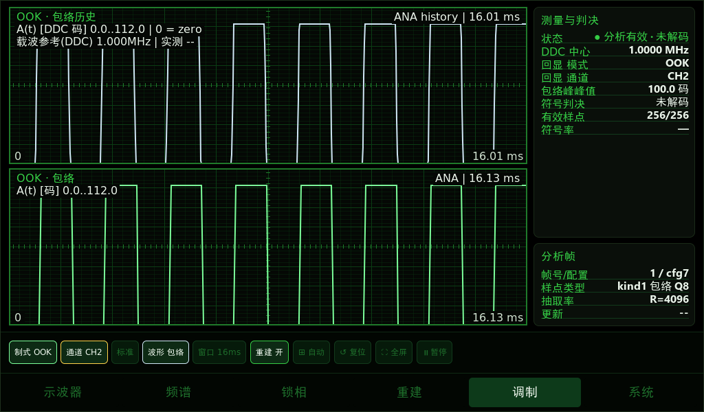
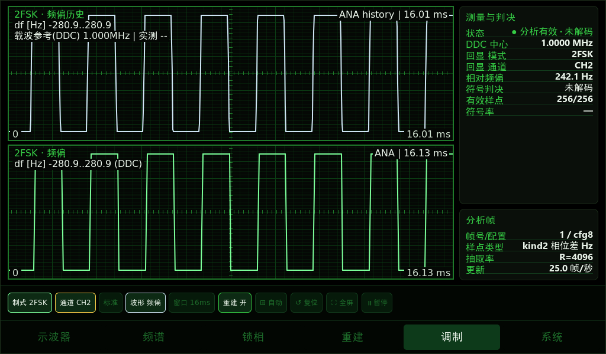
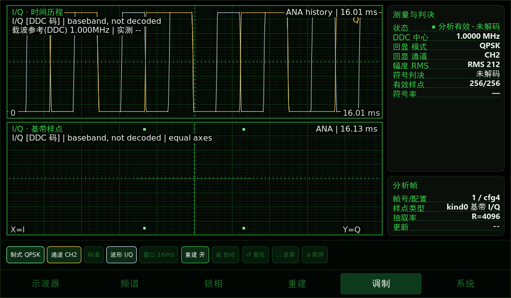

# 数字调制屏端适配与部署

基于载波频率UI版 `8baf509`，在同一 `fpga-modulation-ui-20261026` 分支继续修复。使用现有 `V32ANA1!` 格式，不修改FPGA串口协议，不添加虚构的比特、符号率或误码率。

## 检查结论与修复

原有ANA解析器已按mode/kind校验和转换数据，OOK、2FSK、BPSK、QPSK已有模式命令；但显示与读数适配不完整。

| 屏端模式（A5 E0） | FPGA样点 | 本次上图 | 本次下图及读数 |
|---|---|---|---|
| OOK（5） | kind1，Q8幅度 | 单极性包络历史，保留真实零值与无效断口 | 当前帧包络、包络峰峰值；符号判决=未解码。不再走正弦AM调制度拟合 |
| 2FSK（3） | kind2，有符号相位增量 | 相对DDC中心的频偏历史，Hz | 当前帧正负频偏，峰值为相对DDC的最大绝对频偏；符号判决=未解码 |
| QPSK（4）、BPSK（6） | kind0，完整有符号I/Q | I、Q不同颜色的时间波形及图例 | 等比例坐标的基带样点散点图、I/Q向量模长RMS；明确未解码，不连线伪装已恢复星座 |

所有数字模式状态显示“分析有效 · 未解码”，符号率保持未知。显示控件按制式标为包络、频偏、I/Q、相位；可切换到所选物理通道的原始ADC波形。制式选择和配置回显匹配逻辑保留，不增加自动猜测制式功能。

I/Q上图是时间轴；下图横轴I、纵轴Q，不是时间。两轴使用共同码值量程和相同像素比例，避免宽屏把圆拉成椭圆。散点是实际基带采样点，不是已经抽取的符号时刻；实际频偏会导致旋转或散开，滤波过渡样点会位于簇之间，这些不能靠UI删除成理想二点/四点图。

OOK的0幅度是合法off样点，不是丢帧。kind0的bit31是Q的符号位，不是无效位；不能套用kind1/2/3的无效标记。2FSK频偏单位转换仍为 `signed_phase_step * 65e6 / (R * 65536)`，不是直接把码值标成Hz。

## 部署

先保存工作区改动并确认当前分支。取得本次交付通知里的精确提交号，避免把旧二进制当新版。

```bash
git fetch origin fpga-modulation-ui-20261026
git switch test/fpga-mod-ui   # 或你们当前测试分支的实际名称
git merge --ff-only origin/fpga-modulation-ui-20261026
git rev-parse HEAD
LVGL_DIR=/你们现有LVGL9.1绝对路径 BUILD_DIR=build_digital_mod_ui bash build.sh
file ../out/waveform_demo
sha256sum ../out/waveform_demo
```

有分叉则不要强制覆盖；从本次远端提交另建测试分支，保留原有工作。确认ARMv7 hard-float产物，备份屏上当前二进制，沿用原有传输、停启和串口启动参数。`build.sh`会覆盖`../out/waveform_demo`，也应提前保留该输出。该屏端改动无需更换FPGA bit。

## 验证要求

主机回放覆盖真实ANA解析/CRC、LVGL绘制和模式切换，合成样点只用于软件验证，不属于实机解调验收。原始模式、暂停、无效断口和AM/FM回归也必须通过。

在主机执行`tools/run_modulation_view_test.py`后，可执行`python3 tools/check_digital_view_pixels.py <测试输出目录>`检查真正渲染出的二点/四点是否可见及I/Q像素比例；这会捕获零长度线段无法绘出散点等仅靠数值断言发现不了的问题。当前通过ASan/UBSan回放及上述像素检查。

以下是**主机合成帧**渲染示例，非已恢复星座或实机解调证据：





部署后依次选OOK、2FSK、BPSK、QPSK，回传每项的实际制式/通道/中心频率/抽取率、cfg与fid、CRC及原始接收字节统计、实屏截图。用已知载波、符号率和重复码型的真实信号源逐项验收。发生器CH2接ADC CH0时屏上选择CH1，不能把显示颜色I/Q误认为物理CH1/CH2。

验收重点：OOK有off零电平但不是无效点；2FSK可见两个频率状态；PSK上图有I/Q时间波形，下图是等比例样点，不应显示已解码比特或误码率。切换配置后必须等待匹配回显，不可混入旧制式数据。适当降低符号率以满足当前滤波/抽取带宽，不宣称支持任意速率。

## 仍未实现的能力与独立问题

2026-10-26实机抓包纠正：BPSK原始流含30个CRC正确RAW、QPSK含29个CRC正确RAW，帧头均为1024点；两份流各有372个连续、CRC正确的PSK ANA帧。本端查明旧`[rx] fn=4096`取的是`wave_source.frame_len`固定缓存容量，不是实际帧头，不能据此判断FPGA输出4096点。本次追加修正日志：`fn/dec`从同一已验证RAW帧快照取得；未收有效RAW时为0。启动日志明确写RAW缓存上限，避免再冒充实际点数。本改动不改协议、点数或波特率，也不否认其他时间段可能有CRC问题。

本次提供数字调制的分析数据展示，不实现定时恢复、PSK载波恢复、符号判决、协议解码或真实BER。已有主机参考解调实验不等于这些能力已部署进本屏端。

交换网站#92报告RAW CRC大量失败，应单独抓原始字节和时间统计；不能仅凭假设的25组/s乘包长就认定FPGA必然超发。UART发送器若按ready/backpressure正常排队，需求过高主要降低帧率，CRC失败还需排查实际丢字节、驱动溢出、接线和解析同步。4096点帧体积大确实更容易受丢字节影响。本UI不降低采样点数、不改串口波特率，也不宣称已解决该链路问题。原始频率不可测时载波标签应继续正常降级为DDC参考和实测`--`。
