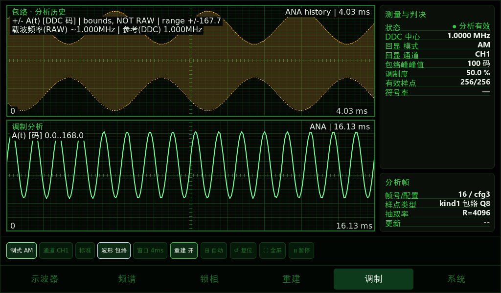
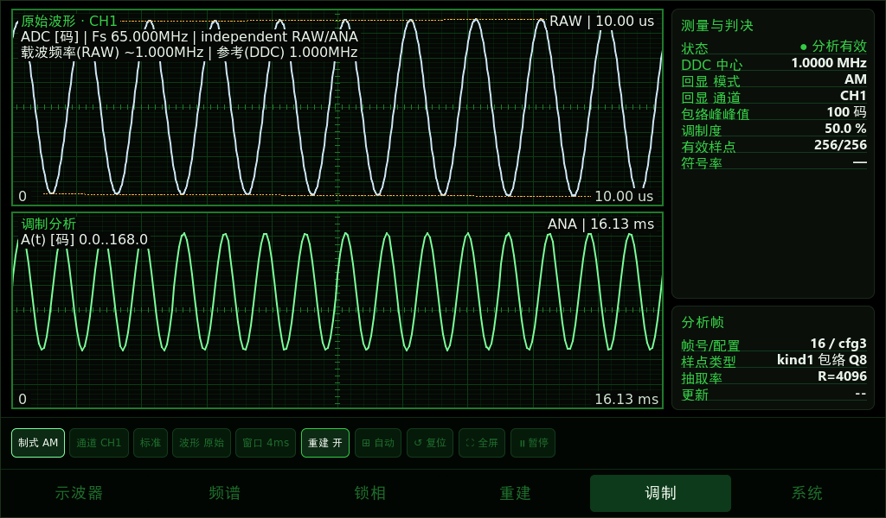

# 调制页 UI：编译与验收

分支：`fpga-modulation-ui-20261026`。基于 `fix/am-accuracy` 的 `f97239c934468d426ff29a859e8061f1cd444767`，保留已有 AM 正弦拟合读数算法。本次只调整屏端程序，不要求更换 FPGA bit，不修改串口线上的帧格式。

## 页面行为

- 上图增加载波频率行：AM 且 RAW 新鲜、过零检测有效、采样率足够、结果接近分析中心时显示 `载波频率(RAW) ~... | 参考(DDC) ...`。这是原始 ADC 数据的粗略过零频率估计，不是高精度频率计，也不宣称自动识别载波波形。其他制式或 RAW 过期/不满足采样条件时只显示 `载波参考(DDC) ... | 实测 --`。DDC 回显始终只当参考设置，不冒充测量值。

- 默认上图显示分析历史；AM 为真实 ANA 幅度的正负边界 ±A(t)，围成关于零对称的淡色填充区域，直观看出调幅轮廓。下图保留当前 ANA 帧的正幅度 A(t)，避免上下两图都只画一条正弦曲线。
- 上图标 `bounds, NOT RAW`：负边界为正包络的镜像，填充仅表示幅度范围，不是实测 RF 载波、ADC 电压或正负两路采样。没有合成高频振荡，不能据此判断载波形状/失真。范围数字是绘图量程（含留白），不是测得峰值。两图分别标时间范围和单位，无效点和填充同时断开。
- “波形 包络/原始”切换上图来源。原始视图保留 ADC 波形，按该 RAW 帧的实际抽取率计算时间轴，不能把 ANA 的历史时长标到 RAW 图上。
- “窗口”提供 4/16/64/256/1024 ms 分析历史观察范围；不足时显示实际可用范围。原始视图沿用原有 RAW 缩放，该按钮禁用。
- 这两个按钮仅改变本地显示，不发送配置命令、不递增 cfg、不触发重配预热。制式、通道、标准等原有设置按钮仍保留原来的下发逻辑。
- RAW 与 ANA 独立更新；RAW 陈旧时标 `RAW stale`，不把旧图当成实时信号。局部金色上下沿仅在采样带宽、可见周期等条件满足时显示，端点不足一个滑窗时留空。
- 无效样点保留断口；不重建虚构载波，不以拟合曲线替换测量波形。AM 幅度单位为 DDC 码，不冒充 ADC 电压。
- I/Q 图为基带轨迹，明确标 `baseband, not decoded`，不宣称已完成载波/定时恢复或协议解码；FM 标相对于 DDC 的频偏 Hz，PM 标相位 deg。
- 暂停冻结调制页显示；后台接收继续。WAVE/ANA 没有共同绝对时间戳，本页不宣称两图逐点同步。

`v32_frame_t.decimation` 是屏端内部缓存元数据，由通过 CRC 的 RAW 帧头带入；不增加 UART 字节，也不改变 FPGA 协议。它避免使用最新配置或整数取整采样率来标旧 RAW 图，支持深抽取率。

## Linux 端编译部署

先保存工作区改动，执行 `git status`，不要直接覆盖正在开发的分支。

```bash
git fetch origin fpga-modulation-ui-20261026
git switch -c test/fpga-modulation-ui-20261026 --track origin/fpga-modulation-ui-20261026
git rev-parse HEAD
# 将下面路径换成你已经使用的 LVGL 9.1 源码绝对路径；toolchain.cmake 应指向现有 RK3506 SDK。
LVGL_DIR=/absolute/path/to/lvgl-release-v9.1 BUILD_DIR=build_modulation_ui bash build.sh
file ../out/waveform_demo
sha256sum ../out/waveform_demo
```

首次创建测试分支即可；已有该本地分支时切回它并检查与远端的差异。使用新的构建目录，避免混用主机和 ARM 缓存。`build.sh` 将产物复制到仓库外的 `../out/waveform_demo`，会覆盖该输出文件，请提前保留旧输出。确认产物为 ARMv7 hard-float，备份屏上当前可运行二进制，沿用现有传输和停止/启动方式部署。启动参数、串口设备、2 Mbaud 配置保持原有实际设置。不要把 FPGA 端主机测试生成的 x86 程序部署到 RK3506。

## 验收与反馈

1. 同一组已知 AM 输入（例如载波 1 MHz、调制 1 kHz、深度 50%），确认发生器 CH2 接 ADC CH0 时屏上选择 CH1。提供发生器实际读回设置。
2. 默认 AM 包络视图：上图金色正负轮廓与淡色填充围成调幅外形，下图绿色正幅度曲线。R=4096、256 点时下图覆盖约 16.13 ms。上图默认约 4 ms，不足时用实际时长。1 MHz 载波/1 kHz 调制时，65 MSPS 的4096点 RAW 只有约63 us，不足一个调制周期；上图轮廓来自 ANA，不冒充长时间 RAW。真正长窗实测 RF 需额外的 FPGA 峰值压缩数据链路，本补丁未实现该链路。
3. 切到原始波形，若当前 RAW 只展示十个 1 MHz 周期，时间轴应约 10 us，不能仍显示 516 ms。下方 ANA 时间轴保持独立。
4. 连续切换本地视图、窗口，记录 cfg 不因这两个控件变化，ANA 计数继续增加；同时检查页面制式/通道与真实回显一致。
5. 保留 CRC、帧率、配置回显日志，上传原始/包络两张屏幕截图。暂停后图不动，恢复后继续；RAW 陈旧和 ANA 失效不能被画成正常实时数据。
6. 使用数字模式时，I/Q 仅作基带观察，不以画出轨迹代替解调验收。

若出现问题，保留日志和截图，按原有方式回退已备份二进制；不要为了回退重置 FPGA 配置或覆盖其他分支。

## 已完成验证及边界

已完成 Linux x86 主机完整 CMake 编译、真实 LVGL 9.1 软件渲染与合成串口帧回放，覆盖独立时间轴、RAW 陈旧、无效断口、flags、I/Q、FM、暂停、深抽取精确采样率和新增中文字体。UI/绘图/解析/数据源测试源码启用 AddressSanitizer、UBSan 与 float-cast-overflow，测试遇到 sanitizer 报告即失败；LVGL 库和其余链接对象使用普通调试构建。

原生主机测试可在准备好的 LVGL 9.1 与主机构建目录上运行：

```bash
python3 tools/run_modulation_view_test.py --build build_host --lvgl /absolute/path/to/lvgl-release-v9.1 --out build_modulation_test
```

附图是主机合成输入的 UI 布局验证图，**不是 RK3506 实机验收**：




实际 ARM 交叉编译、触摸、性能及串口长时运行仍由 Linux 端执行。此前单列的异常长度解析阻塞、SPEC CRC 统计和部分帧快照同步问题不在本 UI 补丁范围内，应继续独立修复。
